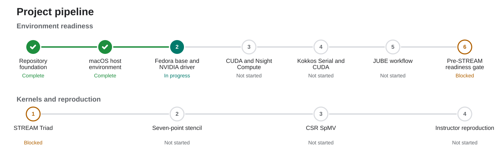

# From STREAM to SpMV: Kokkos vs. native CUDA

This project compares Kokkos and native CUDA implementations of STREAM Triad, a 3D seven-point stencil, and CSR SpMV. Each kernel has an equivalent baseline level and a separately tuned level with a documented, equal variant budget.

**Research question:** How much native-CUDA performance does Kokkos retain before and after both versions are tuned?

## Project progress

<!-- PROGRESS_DASHBOARD:START -->
**Current focus:** Phase 1 — macOS host environment  
**Next milestone:** Validate Kokkos Serial and JUBE on macOS.

**Status legend:** ✅ Complete · 🔄 In progress · ⬜ Not started · 🔒 Blocked · ⚠️ Needs attention

[](docs/PIPELINE.md)

Update this dashboard with `python3 scripts/update_progress_dashboard.py` and the visual with `python3 scripts/generate_progress_svg.py`.

### Environment readiness

| Phase | Milestone | Status | Evidence or next step |
| --- | --- | --- | --- |
| 0 | Repository foundation | ✅ Complete | [Validation evidence](docs/validation/phase-0.md) |
| 1 | macOS host environment | 🔄 In progress | Kokkos Serial and JUBE validation |
| 2 | Fedora base and NVIDIA driver | ⬜ Not started | Fedora post-install setup |
| 3 | CUDA and Nsight Compute | ⬜ Not started | CUDA and profiler smoke tests |
| 4 | Kokkos Serial and CUDA | ⬜ Not started | Kokkos architecture validation |
| 5 | JUBE workflow | ⬜ Not started | End-to-end dummy benchmark |
| 6 | Pre-STREAM readiness gate | 🔒 Blocked | [Requires Phases 1–5](docs/PIPELINE.md#pre-stream-readiness-gate) |

### Kernel progress

| Kernel | Baseline | Tuned | Analysis | Overall status |
| --- | --- | --- | --- | --- |
| STREAM Triad | 🔒 | 🔒 | 🔒 | Blocked by readiness gate |
| Seven-point stencil | ⬜ | ⬜ | ⬜ | Not started; follows STREAM |
| CSR SpMV | ⬜ | ⬜ | ⬜ | Not started; follows stencil |

**Final instructor reproduction:** ⬜ Not started  
**Final cross-kernel analysis:** ⬜ Not started
<!-- PROGRESS_DASHBOARD:END -->

The authoritative checklist is [docs/PIPELINE.md](docs/PIPELINE.md). No benchmark-kernel implementation begins until its pre-STREAM gate passes.

## Execution model

| System | Role |
| --- | --- |
| M4 MacBook Air | Editing, Git, Kokkos Serial correctness smoke tests, and JUBE smoke tests only |
| Fedora 45 laptop | Authoritative CUDA/Kokkos builds, Nsight Compute profiling, JUBE benchmarks, and performance results |
| RTX 4080 Laptop GPU | 12 GB VRAM, compute capability 8.9 (`sm_89`) |

The machines synchronize through Git and key-based SSH. macOS timings never enter GPU comparison tables.

## Build scaffold

Requirements for the current scaffold are CMake 3.25 or newer, Ninja, and a C++20 compiler. Kokkos, CUDA, and test targets are intentionally not integrated yet.

```bash
cmake --preset macos-serial
cmake --build --preset macos-serial
ctest --preset macos-serial
```

Available preset names are `macos-serial`, `fedora-serial`, and `fedora-cuda`. The CUDA preset requires the later Fedora environment-validation phases and currently enables only the CUDA language, not benchmark targets. Machine-specific overrides use an untracked `CMakeUserPresets.json`.

## Documentation

- [Detailed project pipeline](docs/PIPELINE.md)
- [Phase 0 validation evidence](docs/validation/phase-0.md)
- [Environment and version policy](docs/ENVIRONMENT.md)
- [Benchmarking and reporting protocol](docs/BENCHMARK_PROTOCOL.md)
- Kernel experiment cards:
  - [STREAM Triad](docs/kernels/stream.md)
  - [Seven-point stencil](docs/kernels/stencil.md)
  - [CSR SpMV](docs/kernels/spmv.md)
